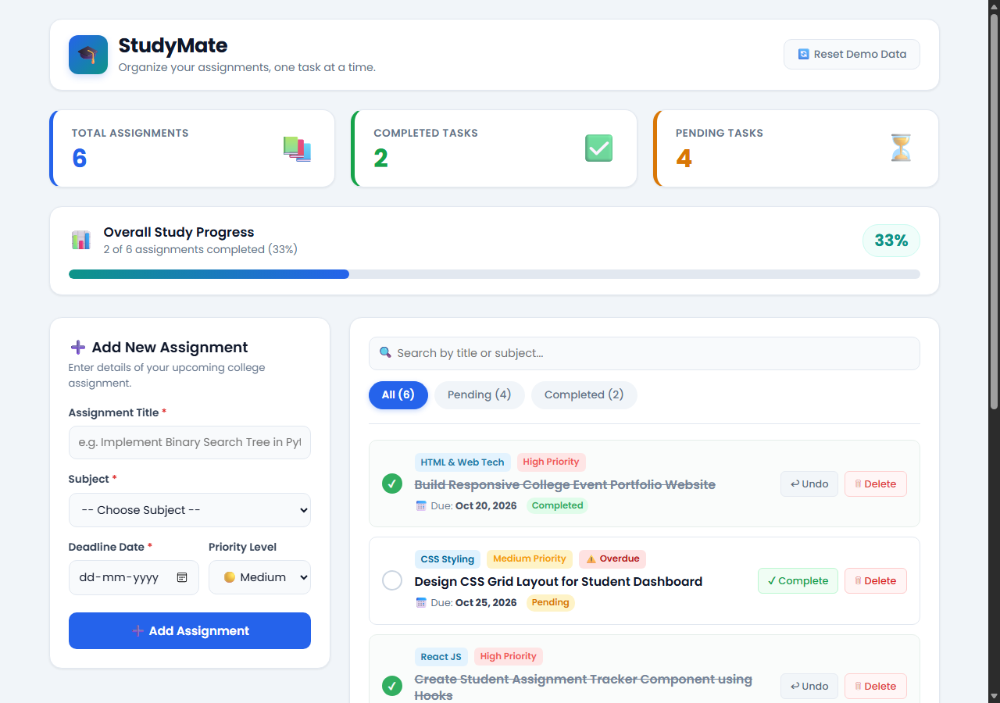
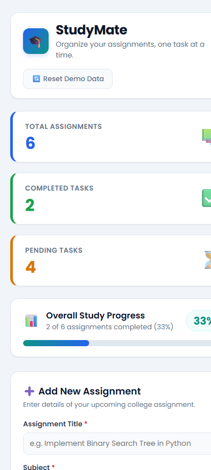

# 🎓 StudyMate – Student Assignment Tracker
### Assignment-2: Individual Full Stack Web Development Project

A comprehensive, responsive web application designed to help university and college students organize, monitor, and complete their academic coursework, lab assignments, and deadlines effortlessly.

- **Developer**: B. Manish Sai (Roll Number: `A24126552129`)
- **Original GitHub Repository**: [https://github.com/Manishsai878/StudyMate](https://github.com/Manishsai878/StudyMate)
- **Live Verified Deployment**: [https://studymate-m1d0.onrender.com/](https://studymate-m1d0.onrender.com/)

---

## 📸 Screenshots

| Desktop Dashboard View | Mobile Responsive View |
|:---:|:---:|
|  |  |

---

## 📌 Project Overview

**StudyMate** is a full-featured single-page application (SPA) created as an individual Full Stack Web Development project. It provides an intuitive, distraction-free student dashboard where users can:
- Track overall coursework completion status in real time.
- View live summary metric cards (Total Assignments, Completed, and Pending tasks).
- Dynamically calculate completion percentage with an animated visual progress bar.
- Add new coursework items with subject, title, due date, and priority levels (High, Medium, Low).
- Automatically flag overdue assignments past their due date (`⚠️ Overdue` indicator).
- Filter assignments instantly by status tabs (**All**, **Pending**, **Completed**) or live search keywords.
- Toggle task completion, undo status, or delete tasks with confirmation safeguards.
- Persist state locally using browser `localStorage` and optionally synchronize with the Node.js/Express REST backend.

---

## 🛠️ Technologies Used

### Frontend
- **React.js 18**: Component-driven architecture using modern functional components and hooks (`useState`, `useEffect`, `useMemo`).
- **Vite 6**: Ultra-fast next-generation frontend tooling and development server.
- **HTML5 (via JSX)**: Accessible, semantic markup structure for cards, forms, and progress indicators.
- **Pure CSS3**: Custom responsive styling, CSS variables, flexbox/grid layouts, smooth animations, and priority color badges (no bulky CSS frameworks).
- **Modern JavaScript (ES6+)**: Functional programming patterns (`filter`, `map`, `reduce`), date calculations, and async operations.
- **Browser LocalStorage API**: Fast client-side persistence ensuring data is preserved across page refreshes and browser sessions.

### Backend & API
- **Node.js**: Asynchronous event-driven JavaScript runtime environment.
- **Express.js 5**: Fast, minimalist RESTful API server providing endpoints for task fetching, creation, deletion, and reset.
- **CORS**: Secure Cross-Origin Resource Sharing middleware enabling frontend-backend communication.
- **JSON File Database**: Lightweight persistent file-based data backup for zero-configuration testing.

---

## ✨ Key Features

1. **Academic Summary Metrics**
   - **Total Assignments**: Real-time count of all registered coursework tasks.
   - **Completed Count**: Distinct count of finished tasks styled with emerald accents.
   - **Pending Count**: Dynamic tally of outstanding tasks requiring attention.

2. **Dynamic Progress Bar & Motivational Caption**
   - Live completion rate calculation from 0% to 100%.
   - Context-aware captions that motivate students based on current progress.

3. **Add Assignment Form with Validation**
   - Mandatory field validation prevents empty submissions.
   - Selectable priority ratings: **High** (urgent), **Medium** (standard), **Low** (routine).

4. **Task Actions & Overdue Detection**
   - Complete / Undo action with instant progress recalculation.
   - Confirmation dialog before deletion prevents accidental data loss.
   - Automatic overdue detection against current system date.

5. **Instant Live Filtering & Search**
   - Instant search bar matching against title and subject simultaneously.
   - One-click status filter tabs: **All**, **Pending**, **Completed**.

6. **Reset Demo Data Feature**
   - Restore default sample B.Tech assignments with a single click.

---

## 📁 Project Folder Structure

```text
Assignment-2-Individual-Project/
├── README.md                     # Comprehensive project documentation
├── package.json                  # Root runner script configuration
├── package-lock.json             # Root dependency lockfile
├── .gitignore                    # Git ignore specifications
├── screenshots/                  # Project screenshots
│   ├── studymate-dashboard.png   # Full desktop dashboard preview
│   └── studymate-mobile.png      # Mobile responsive preview
├── frontend/                     # React Vite frontend application
│   ├── index.html                # Single-page HTML entry point
│   ├── package.json              # Frontend dependencies and build scripts
│   ├── vite.config.js            # Vite bundler configuration
│   ├── vercel.json               # Optional Vercel deployment rewrite rules
│   ├── public/
│   │   └── tasks.json            # 6 initial sample B.Tech assignments
│   └── src/
│       ├── main.jsx              # React DOM mounting entry point
│       ├── App.jsx               # Main React dashboard component & state logic
│       ├── App.css               # Styling for dashboard, cards, form & badges
│       └── index.css             # Global typography, color variables, and reset
└── backend/                      # Node.js Express REST API server
    ├── package.json              # Backend dependencies (express, cors)
    ├── server.js                 # Express server endpoints and static hosting
    └── server/
        └── tasks.json            # Server-side tasks backup
```

---

## 🚀 Installation and Running Instructions

### Prerequisites
- [Node.js](https://nodejs.org/) (version 18.0.0 or higher recommended)
- `npm` (bundled with Node.js)

### Method 1: Running the Complete Full-Stack App (Recommended)

1. Open a terminal in this directory:
   ```bash
   cd Assignments/Assignment-2-Individual-Project
   ```

2. Install dependencies:
   ```bash
   npm install --prefix frontend
   npm install --prefix backend
   ```

3. Start the frontend development server:
   ```bash
   npm run dev
   ```
   Open your browser at `http://localhost:5173`.

4. (Optional) Run the backend API server concurrently in a second terminal:
   ```bash
   npm run server
   ```
   The backend API will be available at `http://localhost:5000`.

### Method 2: Running the Frontend Standalone

```bash
cd frontend
npm install
npm run dev
```

### Production Build Verification

To create an optimized production build:
```bash
npm run build
```
This builds the production bundle into `frontend/dist/`.

---

## 🔗 Repository and Deployment Links

- **Original GitHub Repository**: [https://github.com/Manishsai878/StudyMate](https://github.com/Manishsai878/StudyMate)
- **Live Deployed Application**: [https://studymate-m1d0.onrender.com/](https://studymate-m1d0.onrender.com/)
